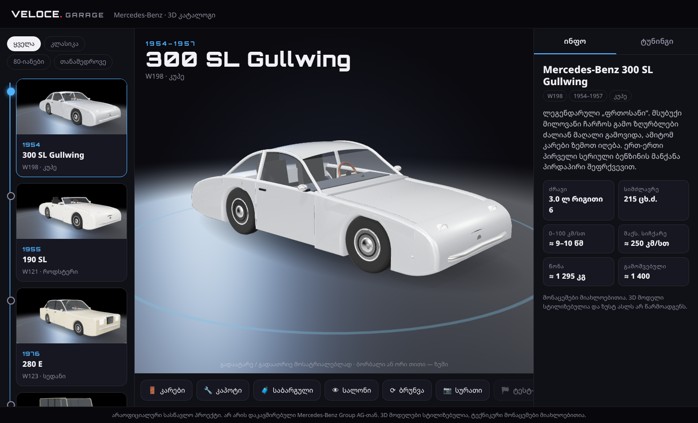

# VELOCE Garage: 3D ავტო-კატალოგი

ინტერაქტიული 3D კატალოგი 21 ნამდვილი მანქანის მოდელით: დაათვალიერე, გააღე კარები, ჩაჯექი სალონში, შეცვალე ტუნინგი და გაიარე ტესტ-დრაივი სამ ტრასაზე.

**Full stack:** საიტს აქვს C# ბექენდი (ASP.NET Core + Microsoft SQL Server): ანგარიშები, საერთო ლიდერბორდი, „ჩემი გარაჟი“ და ადმინ-პანელი. დეტალები და Visual Studio-ში გაშვება: [`backend/README.md`](backend/README.md).

**საიტი:** https://datogeguchadze1.github.io/veloce-car-site/



## კატალოგი

| | მანქანა | შასი | წელი | წამყვანი | სალონი |
|---|---|---|---|---|---|
| Mercedes-Benz | 300 SL Gullwing | W198 | 1954 | უკანა | კოდით აგებული |
| Lada | 2103 „ჟიგული“ | ВАЗ-2103 | 1972 | უკანა | ფაილიდან |
| Porsche | 911 Turbo | 930 | 1975 | უკანა | კოდით აგებული |
| Volkswagen | Golf GTI | Mk1 | 1976 | წინა | ფაილიდან |
| Lada | Niva | ВАЗ-2121 | 1977 | ოთხივე | ფაილიდან |
| Mercedes-Benz | 190 E | W201 | 1982 | უკანა | ფაილიდან |
| Toyota | Sprinter Trueno | AE86 | 1983 | უკანა | ფაილიდან (მარჯვენა საჭე) |
| Ferrari | F40 | F120 | 1987 | უკანა | ფაილიდან |
| Toyota | Supra | A80 | 1993 | უკანა | ფაილიდან |
| BMW | M3 | E36 | 1997 | უკანა | ფაილიდან |
| Mercedes-Benz | S-Class | W221 | 2005 | უკანა | ფაილიდან |
| Mercedes-Benz | SLS AMG | C197 | 2010 | უკანა | ფაილიდან |
| Lamborghini | Huracán | LB724 | 2014 | ოთხივე | ფაილიდან |
| Mercedes-Benz | AMG GT | C190 | 2015 | უკანა | ფაილიდან + კოდით აგებული ხელსაწყოები |
| Audi | R8 V10 | 4S | 2016 | ოთხივე | კოდით აგებული |
| Mercedes-Benz | AMG E 63 S | W213 | 2017 | ოთხივე | ფაილიდან |
| Nissan | GT-R | R35 | 2017 | ოთხივე | ფაილიდან |
| Mercedes-Benz | C 63 AMG DTM | C205 | 2018 | უკანა | ფაილიდან |
| Ferrari | Roma | F169 | 2020 | უკანა | ფაილიდან |
| Porsche | 911 Turbo S | 992 | 2020 | ოთხივე | ფაილიდან |
| Porsche | 911 GT3 RS | 992 | 2023 | უკანა | ფაილიდან |

- **ფილტრები:** მარკა და ეპოქა (კლასიკა, 80–90-იანები, თანამედროვე). მანქანები დროის ხაზზე წლის მიხედვით ლაგდება.
- **3D დათვალიერება:** ტრიალი და ზუმი მაუსით ან თითით.
- **კარები, კაპოტი, საბარგული:** იღება ყველგან, სადაც ფაილში ცალკე ნაწილებია. 911 Turbo S-ის ფაილში ღია დარჩენილი კარი სარკისებური ასლით არის ჩანაცვლებული.
- **სალონის ხედი:** მძღოლის სავარძლიდან, ყველა მანქანაზე გაზომილი თვალის სიმაღლით.
- **ტუნინგი:** ძარის ფერი და საფარი, დისკის ფერი, სუსპენზიის სიმაღლე, მინის ტონირება და სალონის ფერი (რასაც კონკრეტული მოდელი უჭერს მხარს). არჩევანი ბრაუზერში ინახება.
- **სურათი:** მიმდინარე ხედის PNG-ად შენახვა.
- **ინფო-პანელი:** მახასიათებლები, აღწერა და შენი რეკორდები თითოეულ ტრასაზე.

## ტესტ-დრაივი

### ტრასები
დაწყებისას ტრასას ირჩევ, მგზავრობის დროს კი 🗺 / T ცვლის.
- 🏁 **რბოლის ტრასა:** ბორდიურები, სარეკლამო დაფები, ტრიბუნა, პიტ-შენობა, დამცავი ბადე და საბურავების წყობა მოსახვევებში.
- 🏙 **ქალაქის ქუჩები:** 90°-იანი კუთხეები, ზებრა-გადასასვლელები, შუქნიშნები, ხეები, მაღაზიები და შენობები, რომელთა ფანჯრებიც ღამით ანათებს.
- ⛰ **მთის სერპანტინი:** ვიწრო გზა მოაჯირებით, 43 მ-მდე აღმართი და დაღმართი, შევრონის ნიშნები, კლდეები და თოვლიანი მწვერვალები ჰორიზონტზე.

ყველა ტრასას აქვს ცა მზით და ღრუბლებით, 🌙 **ღამე** (N) ვარსკვლავებით, ფანრებით და ფარებით, და 🌧 **წვიმა** (B) სველი, სრიალა გზით.

### ფიზიკა და დრიფტი
- ორღერძიანი მოდელი: თითოეულ ღერძს საკუთარი მოჭიდება აქვს, საბურავი ზღვრის შემდეგ სრიალებს, დამუხრუჭებისას წონა წინ გადადის, აჩქარებისას უკან.
- მოჭიდება, რომელიც წევაზე ან დამუხრუჭებაზე იხარჯება, მოსახვევში აღარ რჩება; ძლიერი მანქანა ბუქსაობს.
- თითოეულ მანქანას თავისი წონა, წონის განაწილება და წამყვანი ღერძი აქვს: უკანაწამყვანი გაზით სრიალში შედის, ოთხწამყვანი მყარად დგას, წინაწამყვანი მოსახვევში წინ გაურბის. ძველ მანქანებს ნაკლები მოჭიდება აქვთ.
- აღმართზე მანქანა ნელდება, დაღმართზე აჩქარდება; ბალახზე მოჭიდება ეცემა.
- **დრიფტი:** ხელის მუხრუჭით ან გაზით შეიყვანე მანქანა სრიალში და კონტრ-საჭით მართე. ქულა სრიალის კუთხესა და სიჩქარეზეა დამოკიდებული, გრძელი დრიფტი ×2-მდე მრავლდება, კედელზე დაჯახება ქულას აკარგვინებს.
- **დრიფტის დამხმარე** (🅳 / H, ნაგულისხმევად ჩართულია) თავად აძლევს კონტრ-საჭეს, ზედმეტ სრიალზე ამცირებს გაზს და მანქანას არ ატრიალებს.
- **გადაცემათა კოლოფი:** ავტომატი ან მექანიკა (M): ბრუნების შემზღუდველით, „მოხრჩობით“ მაღალ გადაცემაზე და ზედმეტად დაბალზე ჩართვის ბლოკით.

### მძღოლი, სალონი და სარკეები
- საჭესთან ზის მძღოლი, რომლის ხელებიც საჭეს ეჭიდება და მასთან ერთად ბრუნავს. ჩაფხუტის ზოლები მანქანის ფერისაა (🪖 / Y ჩაფხუტს ხსნის).
- საჭე ყველა მანქანაზე ბრუნავს. სპიდომეტრი და ტაქომეტრი მოძრაობს 300 SL-ზე, AMG GT-ზე, S-Class-ზე, Supra-ზე, M3-ზე, 2103-ზე, Golf-ზე, GT-R-ზე, GT3 RS-ზე, R8-სა და 930-ზე.
- წინა ბორბლები მოსახვევში ტრიალდება, ყველა ბორბალი სიჩქარის მიხედვით ბრუნავს.
- **სარკეები** (🪞 / V): სალონის ხედში სალონის და ორი გვერდითი სარკე აჩვენებს, რა ხდება უკან.

### განმეორება, რეკორდები, „მოჩვენება“
- **განმეორება** (⏪ / P): ბოლო წრე (ან ბოლო 30 წამი) ხუთი კამერიდან (ტელეკამერები ტრასის გარშემო, უკნიდან, ვერტმფრენი, ბორტზე, ბორბალთან). შეგიძლია დააპაუზო, შეანელო 0.5×-მდე ან 0.25×-მდე და გადაახვიო დროის ზოლზე.
- **რეკორდები:** საუკეთესო წრე და დრიფტი თითოეული მანქანისა და ტრასისთვის ბრაუზერში ინახება.
- **„მოჩვენება“** (👻 / G): საუკეთესო წრის გამჭვირვალე მანქანა. სექტორებზე ჩანს სხვაობა (+/−).

### ტელეფონი
თამაში ჰორიზონტალურად იწყება (სადაც ბრაუზერს ეკრანის შემობრუნება არ შეუძლია, სცენა თავად ბრუნდება). მართვა: ◀ ▶ საჭე ან ტელეფონის დახრა (📱), ანალოგური გაზისა და მუხრუჭის პედლები (რაც უფრო ქვემოთ აჭერ, მით ძლიერად) და ბერკეტის ფორმის ხელის მუხრუჭი. დაჯახებისას, გადართვისას და ხელის მუხრუჭზე ტელეფონი ვიბრირებს (Android).

### მართვა კლავიატურით

| კლავიში | მოქმედება | ღილაკი |
|---|---|---|
| W / ↑ | გაზი | |
| S / ↓ | მუხრუჭი, უკუსვლა | |
| A D / ← → | საჭე | |
| Space | ხელის მუხრუჭი | |
| M | ავტომატი / მექანიკა | A / M |
| E / Q | გადაცემა ზემოთ / ქვემოთ (მექანიკა) | |
| C | კამერა: უკნიდან / სალონიდან (განმეორებაში: კამერების გადართვა) | 🎥 |
| P | განმეორება | ⏪ |
| V | სარკეები | 🪞 |
| Y | ჩაფხუტი | 🪖 |
| H | დრიფტის დამხმარე | 🅳 |
| G | „მოჩვენება“ | 👻 |
| N | დღე / ღამე | 🌙 |
| B | მშრალი / წვიმა | 🌧 |
| T | ტრასის შეცვლა | 🗺 |
| R | ტრასაზე დაბრუნება | ↺ |
| Esc | გასვლა (განმეორებიდან დაბრუნება) | ✕ |

## ანგარიშები და ბექენდი
- **შესვლა / რეგისტრაცია**: ზედა მარჯვენა კუთხეში. სახელი ჩანს ლიდერბორდზე.
- **საერთო ლიდერბორდი**: ინფოს ჩანართში, თითოეული მანქანისა და ტრასისთვის (საუკეთესო წრე და დრიფტი). ტესტ-დრაივის შემდეგ HUD აჩვენებს შენს ადგილს, ხოლო ტრასის ბარათებზე ჩანს მსოფლიო რეკორდი.
- **ჩემი გარაჟი**: რჩეული მანქანები (★), შენახული ტუნინგები (ტუნინგის ჩანართში „💾 შენახვა“) და შენი რეკორდები.
- **ადმინ-პანელი** (`admin.html`): კატალოგის ტექსტების რედაქტირება და მანქანების დამალვა, მომხმარებლები, საეჭვო რეკორდების წაშლა.

ბექენდის გარეშე (მაგ. GitHub Pages) ეს ღილაკები იმალება და საიტი ძველებურად მუშაობს: რეკორდები და ტუნინგი ბრაუზერში ინახება.

## გაშვება
**ბექენდით:** Visual Studio-ში გახსენი `backend/Veloce.sln` და დააჭირე F5 (საიტი და API ერთად, `http://localhost:5080`). ინსტრუქცია: [`backend/README.md`](backend/README.md).

**მხოლოდ საიტი:** build არ სჭირდება, მაგრამ ES მოდულების გამო ლოკალური სერვერია საჭირო:

```bash
python3 -m http.server 8000
# გახსენი http://localhost:8000
```

GitHub Pages: Settings → Pages → Deploy from branch → `main`. Netlify: `netlify.toml` (საიტი Netlify-ზე, API ASP.NET ჰოსტინგზე, `/api` გადამისამართებით).

## სტრუქტურა

| ფაილი | დანიშნულება |
|---|---|
| `index.html` | გვერდის განლაგება |
| `css/style.css` | სტილები (კომპიუტერი და ტელეფონი, ტესტ-დრაივის HUD) |
| `js/main.js` | სცენა, კამერა, კატალოგი, პანელები, რენდერის ციკლი |
| `js/models.js` | კატალოგის მონაცემები და თითოეული მოდელის ჩატვირთვის პარამეტრები |
| `js/glbCar.js` | მოდელის ჩატვირთვა: კარები, საჭე, ბორბლები, ხელსაწყოების ისრები, ტუნინგი |
| `js/cabinKit.js` | კოდით აგებული სალონები (300 SL, 930, R8) და AMG GT-ის ხელსაწყოები |
| `js/tuning.js` | ტუნინგის ვარიანტები |
| `js/drive.js` | ტესტ-დრაივი: ტრასები, ფიზიკა, კამერები, HUD, მართვა, რეკორდები, განმეორება |
| `js/scenery.js` | ცა, ღრუბლები, ჰორიზონტი და ტრასის გარშემო დეტალები |
| `js/driver.js` | მძღოლი ჩაფხუტით და საჭეზე მოჭიდებული ხელებით |
| `js/mirrors.js` | სარკეები სალონის ხედში |
| `js/engineSound.js` | ძრავის, საბურავების, დარტყმის, გამონაბოლქვის და წვიმის ხმა |
| `js/api.js` | API-სთან კავშირი (ტოკენი, შეცდომები, ბექენდის არსებობის შემოწმება) |
| `js/account.js` | შესვლის ფანჯარა, მენიუ, „ჩემი გარაჟი“, ლიდერბორდი, შედეგების გაგზავნა |
| `admin.html`, `js/admin.js`, `css/admin.css` | ადმინ-პანელი |
| `backend/` | C# API: `Veloce.sln`, `Veloce.Api/` (კონტროლერები, EF Core, მიგრაციები), `tests/api-smoke.mjs` |
| `netlify.toml` | Netlify-ის პარამეტრები |
| `models/` | 3D მოდელები (თითო საქაღალდე: `scene.gltf`, `scene.bin`, `textures/`, `license.txt`) |
| `thumbs/` | კატალოგის სურათები (`?thumbs` პარამეტრით ახლიდან იხატება) |
| `tools/inspect-glb.mjs` | მოდელის ობიექტების, მასალებისა და ზომების ჩამონათვალი |
| `tools/optimize_gltf.py` | მოდელის შეკუმშვა (გეომეტრიის კვანტიზაცია, ტექსტურების შემცირება) |
| `tools/glb2gltf.py` | `.glb` ფაილის საქაღალდედ გაშლა შეკუმშვამდე |
| `vendor/three/` | Three.js r187 (MIT) |
| `legacy-landing.html` | ძველი ერთგვერდიანი VELOCE GT-R საიტი |

## ახალი მანქანის დამატება
მოდელი ჩადე `models/<id>/`-ში, შეკუმშე და `js/models.js`-ში დაამატე ჩანაწერი `glb` ველით. დეტალური ინსტრუქცია (ლიცენზიები, შემოწმება, შეკუმშვა, ჩატვირთვის ყველა პარამეტრი, კატალოგის სურათი): [`models/README.md`](models/README.md).

## ლიცენზიები
ყველა მოდელის ავტორი და ლიცენზია ჩამოთვლილია [`CREDITS.md`](CREDITS.md)-ში. მოდელები CC BY 4.0-ითაა. გამონაკლისია BMW M3, რომლის ლიცენზია (CC BY-NC-SA 4.0) კომერციულ გამოყენებას კრძალავს.

## შენიშვნა
არაოფიციალური სასწავლო პროექტი. არ არის დაკავშირებული არცერთ ავტომწარმოებელთან; მარკები მათი მფლობელების სავაჭრო ნიშნებია. ტექნიკური მონაცემები მიახლოებითია.
